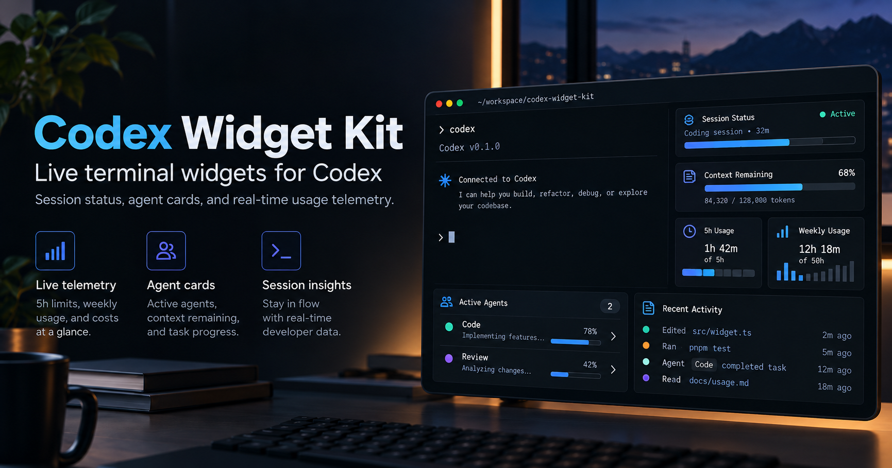

<div align="center">

# Codex Widget Kit


### Your Codex session, at a glance.

**Read-only live usage, task progress, and sub-agent cards alongside Codex CLI.**



<sub>Conceptual UI illustration of the visual direction, not a live screenshot. Some pictured cards and figures are planned for v0.2.0; see the supported features below.</sub>

[Social preview image · 1280 × 640](assets/social-preview.png)

[](https://github.com/MakeItEzzz555/codex-widget-kit/actions/workflows/test.yml)


[](LICENSE)

**Zero dependencies · Read-only · Matches Codex's own numbers · MIT-licensed**

[Install](#install) · [What you get](#what-you-get) · [How it works](#how-it-works) · [Capabilities](CAPABILITY.md) · [Widget ideas](IDEAS.md) · [Claude Code version](https://github.com/MakeItEzzz555/claude-widget-kit)

</div>

---

### How much of my 5-hour limit is left? Is it still thinking hard? How long until it's done?

Codex knows all of that, and writes it down as it works. **Codex Widget Kit draws it**: three braille rings, a heat-coloured effort meter, a progress bar that learns the pace of your plan, and a card for every sub-agent Codex spawns. Everything updates once a second, in a separate terminal pane you can put anywhere.

It's the Codex port of [`turn-meters`](https://github.com/MakeItEzzz555/claude-widget-kit) from the Claude Widget Kit. The visuals are the same. Codex has no API for drawing inside its own interface, so the widgets get a terminal of their own.


## What you get

| Widget | What it shows | Source |
|---|---|---|
| **5h ring** | Share of your 5-hour limit left; green > 50 %, amber > 20 %, red below | `rate_limits` window of 300 min |
| **Week ring** | Share of your weekly limit left | `rate_limits` window of 10 080 min |
| **Context ring** | Context window left, computed exactly like Codex's `context-remaining` | `last_token_usage` and `model_context_window` |
| **Effort meter** | `▂▃▄▆█` ticks from minimal to xhigh, plus the model | `turn_context` |
| **Task bar + ETA** | Steps done, the step it's on, and a time estimate from the pace so far | `update_plan` calls |
| **Agent cards** | One card per live sub-agent: nickname, role, running/idle, model and effort | sub-agent rollouts, `closeAgent` |
| **Status line** *(optional)* | Codex's built-in footer items, set up to mirror the band | `[tui].status_line` |

The rings sit beside the effort and task rows when the pane is wide enough. In a narrow pane they stack. Colour follows `NO_COLOR`, and piped output is plain text.

## Install

### One command

```bash
curl -fsSL https://raw.githubusercontent.com/MakeItEzzz555/codex-widget-kit/main/install.sh | sh
```

This clones the kit into `~/.codex/widget-kit` and links `codex-widgets` into `~/.local/bin`. Add `-s -- --statusline` to also turn on Codex's built-in status line. That edits `~/.codex/config.toml`, but only after taking a dated backup, and it prints the diff.

### Let Codex install it for you

Paste the prompt from [INSTALL_PROMPT.md](INSTALL_PROMPT.md) into Codex. It runs the installer, checks the result and tells you how to open the pane.

### From a release or by hand

Download `codex-widget-kit-<version>.tgz` from [Releases](https://github.com/MakeItEzzz555/codex-widget-kit/releases) and run `npm install -g ./codex-widget-kit-<version>.tgz`, or:

```bash
git clone https://github.com/MakeItEzzz555/codex-widget-kit.git
node codex-widget-kit/bin/codex-widgets.mjs
```

Needs Node.js 20 or newer and Codex CLI (tested with 0.163). macOS and Linux.

## Run it beside Codex

`codex-widgets` follows the newest Codex session started in the folder it runs in. Open a second pane in your project and run it there:

| Terminal | Split |
|---|---|
| **tmux** | `tmux split-window -h -l 48 codex-widgets` |
| **Ghostty** | `⌘D`, then `codex-widgets` |
| **iTerm2** | `⌘D`, then `codex-widgets` |
| **macOS Terminal** | a second window: `⌘N`, then `cd` to the project and run `codex-widgets` |
| **VS Code / Cursor** | split the integrated terminal, then `codex-widgets` |

```text
codex-widgets [--cwd <folder>] [--once]
  --cwd   follow the session for another folder (default: the current one)
  --once  print one frame and exit, e.g. for scripts or a quick look
```

## How it works

```text
  codex  ──writes──▶  ~/.codex/sessions/YYYY/MM/DD/rollout-*.jsonl
                                   │  (read-only, tailed once a second)
                                   ▼
                     codex-widgets: newest session for this folder
                       + every sub-agent whose parent is that session
                                   │
                 ┌─────────────────┼─────────────────┐
                 ▼                 ▼                 ▼
          usage rings       effort + tasks       agent cards
```

- **Read-only.** It never writes to `~/.codex`, never touches `auth.json`, history or databases, and never sends anything anywhere. It reads only the fields listed in [CAPABILITY.md](CAPABILITY.md). Prompts, outputs and messages are skipped without being read.
- **Honest numbers.** The context ring uses Codex's own formula, with its 12k-token baseline. If Codex hasn't reported a reading yet, the ring stays hidden. No plan means no task bar, and no sub-agents means "No agents running". Nothing is ever estimated from thin air.
- **Robust.** It skips malformed lines, waits for half-written lines to finish, and re-scans for new sessions every 5 seconds.

## Status line

Codex's built-in status line can mirror the band inside Codex itself:

```toml
[tui]
status_line = ["model-with-reasoning", "task-progress", "context-remaining", "five-hour-limit", "weekly-limit", "run-state", "git-branch"]
status_line_use_colors = true
```

Copy it from [config/statusline.toml](config/statusline.toml), or let `install.sh --statusline` merge it for you.

## Uninstall

```bash
curl -fsSL https://raw.githubusercontent.com/MakeItEzzz555/codex-widget-kit/main/install.sh | sh -s -- --uninstall
```

Your `config.toml` is left alone. Restore the `config.toml.before-widget-kit-*` backup if you turned the status line on.

## Develop

```bash
npm test          # node --test, zero dependencies
node bin/codex-widgets.mjs --once --cwd "$PWD"
```

[Capabilities and limits](CAPABILITY.md) · [Widget ideas](IDEAS.md) · [Security](SECURITY.md) · [Contributing](CONTRIBUTING.md) · [Changelog](CHANGELOG.md)

---

<div align="center">

**Codex Widget Kit: know where your session stands, without asking.**

*Not affiliated with OpenAI. Codex is a trademark of OpenAI.*

</div>
