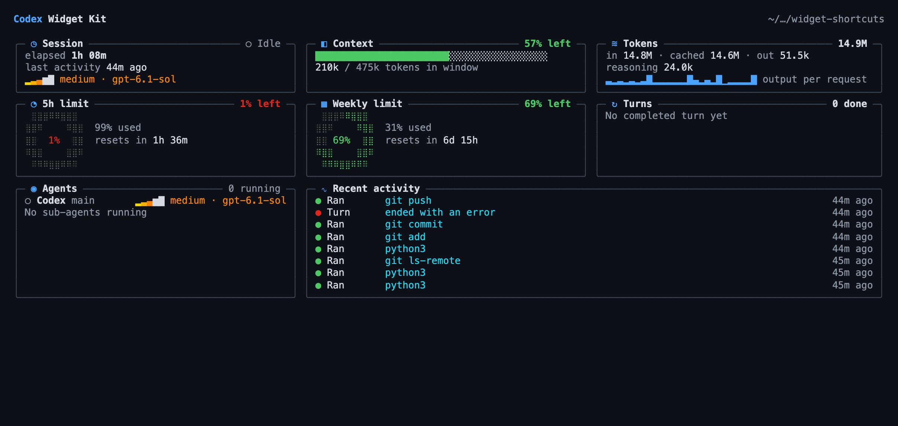

<div align="center">

# ◔ Codex Widget Kit

### Your Codex session, at a glance.

**A live developer dashboard for OpenAI Codex CLI: session, context, tokens, turns, limits, tasks, sub-agents and recent activity, in its own terminal pane.**

[](https://github.com/MakeItEzzz555/codex-widget-kit/actions/workflows/test.yml)


[](LICENSE)

**Zero dependencies · Read-only · Matches Codex's own numbers · MIT-licensed**

[Install](#install) · [What you get](#what-you-get) · [How it works](#how-it-works) · [Capabilities](CAPABILITY.md) · [Widget ideas](IDEAS.md) · [Claude Code version](https://github.com/MakeItEzzz555/claude-widget-kit)

</div>

---

### How much of my 5-hour limit is left? How full is the context? How many tokens has this session used? What did Codex just run?

Codex knows all of that, and writes it down as it works. **Codex Widget Kit draws it** as a grid of cards that follows your terminal width: three columns from 132 columns, two from 76, one from 40, and a compact one-reading-per-line view below that. It updates once a second, in a separate pane you can put anywhere.

It's the Codex port of [`turn-meters`](https://github.com/MakeItEzzz555/claude-widget-kit) from the Claude Widget Kit. Codex has no API for drawing inside its own interface, so the dashboard gets a terminal of its own.



*A real session at 150 columns, captured from the terminal (no mock data). At 80 columns the same cards stack two by two: [screenshot](docs/screenshots/dashboard-80.png).*

## What you get

| Widget | What it shows | Source |
|---|---|---|
| **Session** | Running or idle, elapsed time, the live turn's time, last activity, effort and model | `session_meta` timestamp, `task_started` / `task_complete`, `turn_context` |
| **Context** | Context left, computed exactly like Codex's `context-remaining`, tokens in the window, and how often it was compacted | `last_token_usage`, `model_context_window`, `ContextCompaction` items |
| **Tokens** | Session totals: input, cached input, output, reasoning, with a sparkline of output tokens per request | `token_count.info.total_token_usage` |
| **5h limit · Weekly limit** | Share left (the v0.1 braille ring in wide layouts), share used, and the reset countdown | `rate_limits` windows of 300 and 10 080 min, `resets_at` |
| **Turns** | Completed turns, average and last length, live turn, a sparkline of turn lengths. A count, never "n of m": Codex has no turn quota | `task_complete.duration_ms`; a turn that ended on an error is not counted |
| **Tasks** | Steps done, the step it's on, and an ETA labelled `est.` from the pace so far | `update_plan` calls (hidden when Codex runs without a plan) |
| **Agents** | The main thread and every live sub-agent: nickname, role, running/idle, model, effort, and its plan when it has one | sub-agent rollouts, `closeAgent` |
| **Recent activity** | The last 8 events: commands (program and subcommand only, with a non-zero exit code), files created/edited/deleted (last two path parts), MCP calls, sub-agent starts, compactions, failed turns | `item_completed` items |
| **Status line** *(optional)* | Codex's built-in footer items, set up to mirror the dashboard | `[tui].status_line` |

Every reading says when it's missing ("Waiting for rate limits", "No completed turn yet") instead of showing a made-up number. See [CAPABILITY.md](CAPABILITY.md) for the source of every field.

## Install

### One command

```bash
curl -fsSL https://raw.githubusercontent.com/MakeItEzzz555/codex-widget-kit/main/install.sh | sh
```

This clones the kit into `~/.codex/widget-kit` and links `codex-widgets` into `~/.local/bin`. Add `-s -- --statusline` to also turn on Codex's built-in status line. That edits `~/.codex/config.toml`, but only after taking a dated backup, and it prints the diff.

### Let Codex install it for you

Paste the prompt from [INSTALL_PROMPT.md](INSTALL_PROMPT.md) into Codex. It runs the installer, checks the result and tells you how to open the pane.

### From a release or by hand

Download `codex-widget-kit-<version>.tgz` from [Releases](https://github.com/MakeItEzzz555/codex-widget-kit/releases) and run `npm install -g ./codex-widget-kit-<version>.tgz`, or:

```bash
git clone https://github.com/MakeItEzzz555/codex-widget-kit.git
node codex-widget-kit/bin/codex-widgets.mjs
```

Needs Node.js 20 or newer and Codex CLI (tested with 0.163). macOS and Linux.

## Run it beside Codex

`codex-widgets` follows the newest Codex session started in the folder it runs in. Open a second pane in your project and run it there:

| Terminal | Split |
|---|---|
| **tmux** | `tmux split-window -h -l 80 codex-widgets` |
| **Ghostty** | `⌘D`, then `codex-widgets` |
| **iTerm2** | `⌘D`, then `codex-widgets` |
| **macOS Terminal** | a second window: `⌘N`, then `cd` to the project and run `codex-widgets` |
| **VS Code / Cursor** | split the integrated terminal, then `codex-widgets` |

```text
codex-widgets [--cwd <folder>] [--once] [--layout auto|compact|standard|expanded] [--theme dark|light] [--ascii]
  --cwd     follow the session for another folder (default: the current one)
  --once    print one frame and exit, e.g. for scripts or a quick look
  --layout  auto follows the width; compact is one line per reading; standard caps the grid at two columns
  --theme   dark (default) or light; picked from COLORFGBG when it says the background is light
  --ascii   plain ASCII borders, bars and ticks, for fonts without box drawing or braille (also when TERM=dumb)
```

`NO_COLOR` turns colour off; every reading stays readable without it.

## How it works

```text
  codex  ──writes──▶  ~/.codex/sessions/YYYY/MM/DD/rollout-*.jsonl
                                   │  (read-only, tailed once a second)
                                   ▼
                     codex-widgets: newest session for this folder
                       + every sub-agent whose parent is that session
                                   │
              ┌──────────────┬─────┴──────┬──────────────┐
              ▼              ▼            ▼              ▼
       session/turns   context/tokens   limits     agents/activity
```

- **Read-only.** It never writes to `~/.codex`, never touches `auth.json`, history or databases, and never sends anything anywhere. It reads only the fields listed in [CAPABILITY.md](CAPABILITY.md). Prompts, outputs and messages are skipped without being read.
- **Honest numbers.** The context ring uses Codex's own formula, with its 12k-token baseline. If Codex hasn't reported a reading yet, the ring stays hidden. No plan means no task bar, and no sub-agents means "No agents running". Nothing is ever estimated from thin air.
- **Private.** Commands show their program and subcommand (`npm test`), never arguments, environment or output. Paths show their last two parts (`src/widget.ts`). Control characters are stripped before drawing.
- **Robust and bounded.** It skips malformed lines, waits for half-written lines to finish, and re-scans for new sessions every 5 seconds. Rollouts are read in 8 MB chunks; a synthetic 200 MB rollout parsed in about 0.3 s with a 65 MB heap, and the state it keeps is capped (8 activity rows, 32 sparkline samples, 500 file paths).
- **Light on the terminal.** Only the lines that changed are rewritten, and a frame taller than the pane is cut to fit.

## Status line

Codex's built-in status line can mirror the dashboard inside Codex itself:

```toml
[tui]
status_line = ["model-with-reasoning", "task-progress", "context-remaining", "five-hour-limit", "weekly-limit", "run-state", "git-branch"]
status_line_use_colors = true
```

Copy it from [config/statusline.toml](config/statusline.toml), or let `install.sh --statusline` merge it for you.

## Uninstall

```bash
curl -fsSL https://raw.githubusercontent.com/MakeItEzzz555/codex-widget-kit/main/install.sh | sh -s -- --uninstall
```

Your `config.toml` is left alone. Restore the `config.toml.before-widget-kit-*` backup if you turned the status line on.

## Develop

```bash
npm test          # node --test, zero dependencies
node bin/codex-widgets.mjs --once --cwd "$PWD"
```

[Capabilities and limits](CAPABILITY.md) · [Widget ideas](IDEAS.md) · [Security](SECURITY.md) · [Contributing](CONTRIBUTING.md) · [Changelog](CHANGELOG.md)

---

<div align="center">

**Codex Widget Kit: know where your session stands, without asking.**

*Not affiliated with OpenAI. Codex is a trademark of OpenAI.*

</div>
